<div align="center">

# VelorenBench

**An Open-World 3D Fantasy RPG Benchmark for Autonomous Multimodal & Tool-Using Agents in Veloren**

[](PROVENANCE.md)
[](TASKS.md)
[](SUPPORT.md)
[](#three-ways-to-see-the-same-world)
[](NOTICE.md)
[](https://wyaaaattwho.github.io/VelorenBench/)

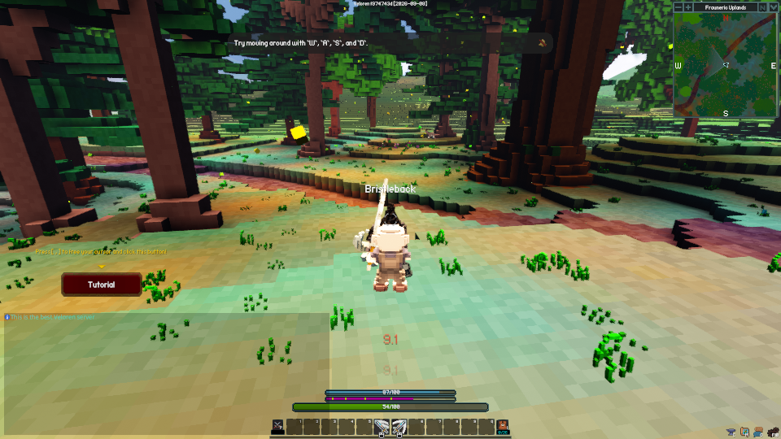

**Observe like a player. Act through the game. Prove effects in the world.**

[Project Website · 中 / EN](https://wyaaaattwho.github.io/VelorenBench/) ·
[29-Task Compendium](#the-complete-29-task-compendium) ·
[Quickstart](#quickstart) · [API](API.md) · [Build Guide](BUILD.md) · [Citation](#citation)

</div>

## Overview

VelorenBench places external agents inside **[Veloren](https://veloren.net/)**,
an open-world voxel fantasy RPG. Tasks connect language, spatial reasoning,
resource planning, native crafting, combat, healing, trade and quest contracts.
The agent must cause genuine game effects—not merely describe a plausible plan.

The **1.1.0 engineering source** preserves **29 task definitions / 37 authored
terrain cells** and packages **125 evidence-backed exact selections**: 40
Structured, 40 Hybrid, and 45 Image selections (40 full-UI + 5 legacy motor).
Counts include terrain and weapon variants; they are **not 125 distinct tasks**.
T06’s four weapons are conditions of one task. All 29 definitions have full-UI
image engineering coverage, but **T05/Image is task-engineering-only**.
35 legacy `visual-motor-v1` combinations remain explicitly unsupported.
Always inspect native-bound support for the exact run mode.

> **Evidence, not a leaderboard.** Engineering qualification establishes bounded
> interface/effect coverage for an exact task/profile/code/native identity. It
> does not establish model task success, broad performance, cross-platform
> certification or a clean-machine turnkey install. The 1.1.0 source branch is
> not a claim of a new Git tag or paper/DOI. See [provenance](PROVENANCE.md).

### What makes this benchmark different?

- **A strict Public/Private Mediation Boundary.** Agents receive player-legal
  observations and own motor/UI/semantic tools. Evaluator-owned private ECS
  evidence verifies actual inventory, equipment, damage, healing, trade,
  dialogue and quest settlement. Setup privilege and oracle data are not
  player tools; private qualification controllers are not distributed.
- **Three observation modalities**, with explicit action profiles and no silent
  structured fallback for image-only agents.
- **Multi-harness ecosystem:** the official **DeepSeek Harness (`dsh`) adapter**,
  external **GameAgent** (asynchronous Brain + Jev executive), and the standard
  **Responses API** entry. External runtimes, providers and credentials are
  separately supplied; GameAgent is not bundled.
- **Read-only web viewer and passive X11 MP4 recorder** via
  `rpg-benchmark visualize`. Ordinary benchmark runs do not automatically start
  the viewer or recorder.
- **Auditable outcomes:** task satisfaction, validity, transport and cleanup
  are reported separately, with source/build identities and per-episode evidence.
- **Dependency-free Python runtime**, Python **3.13+**. The native renderer has
  separate platform, GPU, build and asset prerequisites.

## Three ways to see the same world

| Modality | Observations | Action profile / boundary |
| --- | --- | --- |
| **Structured** | Ordinary player-visible state, legal recipe/map/dialogue/inventory information and owned action receipts | `ordinary-renderer-native-v1`; no private judge/ECS access |
| **Hybrid** | The same legal structured interface, with on-demand `game_frame` images | `ordinary-renderer-native-v1`; pixels supplement rather than replace ordinary observations |
| **Image-Only** | Native renderer PNGs and visual semantic HUD, with public goal/interface metadata and owned receipts—not hidden structured world state | Full `visual-ui-v1` HUD + motor control; explicit `visual-motor-v1` remains narrowly admitted |

The full visual UI supports real in-game inventory, crafting, dialogue, map,
trade, skill and ability controls. Image-only does **not** mean semantic JSON
world observations hidden behind screenshots. Native frame/control fences and
actor/session attribution are part of the interface contract. An adapter’s
negotiated effective profile is checked; no automatic profile upgrade is implied.

## Architecture & evaluation methodology

```text
       Responses API       DeepSeek Harness       GameAgent
             \                  |                  /
               Public agent / external-adapter interface
               Player goal · legal observations · owned tools
                                   │
                 PUBLIC / PRIVATE MEDIATION BOUNDARY
                                   │
                 Native Veloren world + renderer + HUD
                  ↕ inventory / movement / combat / NPCs
                                   │
              Evaluator-owned private evidence and native oracle
             Effect attribution · task predicates · validity · cleanup
```

1. **Select and pin** the task, terrain, seed, variant, observation/action profile,
   adapter, code and native binary/assets identity. Source-only support declares
   implementation; the packaged registry governs exact native-bound admission.
2. **Construct and validate** the seeded private fixture. The measured player is
   not an administrator. Setup-only checks do not count as agent achievement.
3. **Run the external agent** through the permitted public interface. The
   evaluator owns horizon and termination; unknown provenance remains unknown.
4. **Join actual native effects** to the correct actor/session/target and
   task-specific predicates. A successful API call, an enemy disappearing or a
   model saying “done” is not success evidence.
5. **Report goal and measurement separately.** Disclose invalid/setup failures,
   attribution uncertainty, transport, cleanup, retries and denominators.

Report task/terrain/variant; attempts and valid episodes; seeds and fixture;
source/build/scorer identity; modality/profile; adapter and declared model/effort;
runtime model metadata (`unknown` if unavailable); tool budget and evaluation
horizon (including unset); success/validity rules; setup/transport/cleanup counts;
aggregation and retry policy. Do not discard failed attempts or compare different
supported-cell denominators without disclosure.

## The complete 29-task compendium

Each entry includes a **real native 960×540 Veloren renderer image**, initial
conditions, the agent challenge and native success predicates. The screenshot
is an **environment illustration**, not proof that an agent completed the task.
Archive images and new two-tool no-model captures are distinguished in
[media provenance](docs/assets/media-provenance.json); no task image is generated
art or a different task relabelled as its own.

Task goals and scorers remain unchanged. Exact definitions are in
[`scenes.json`](harness/scripts/rpg_benchmark/scenes.json);
[TASKS.md](TASKS.md) and [SUPPORT.md](SUPPORT.md) distinguish terrain/profile
coverage from capability admission. All tasks below expose Structured, Hybrid
and full-UI Image interfaces under their admitted modes.

<!-- BEGIN TASK COMPENDIUM -->

### ✧ Information Seeking & Dynamic Route Adaptation

<details id="task-t01">
<summary><b>T01 · The Resident’s Workshop</b></summary>

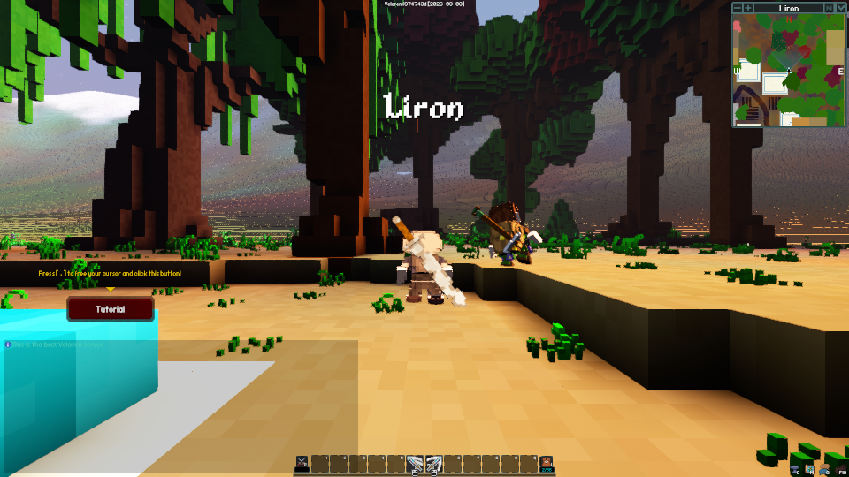

**Family:** Information Seeking & Dynamic Route Adaptation<br>
**Terrain:** natural<br>
**Required capabilities:** `dialogue, map, movement`<br>
**Modalities:** Structured · Hybrid · Image (`visual-ui-v1`) — exact native-key admission applies.

**Scenario & initial state.** Start in Liron without workshop coordinates. A real resident and a real CraftingBench facility provide the missing information through ordinary dialogue and a persistent map marker.

**Agent challenge.** Ground the offered workshop response in the resident’s dialogue, interpret the marker, choose a route and enter the facility rather than merely reaching town.

**Native oracle.** Same actor/session; correlated talk and offered workshop response; received marker for the selected facility with separate private recipient validation; alive, grounded arrival within 1 m horizontal / 0.5 m vertical of the floor point 2 m north of the bench, speed ≤0.1 m/s in two fresh observations ≥0.25 s apart. Missing private marker attribution is unknown, not a clean success.

**Authored goal:** In Liron, ask an actual resident for directions to a workshop, receive the resident's workshop information, then find and enter that real workshop. Settle alive in its CraftingBench area: within one metre horizontally and half a metre vertically of the floor point two metres north of the bench centre. Be on the ground at speed at most 0.1 m/s for two observations at least 0.25 seconds apart. The normal resident dialogue and received map marker provide the missing location information; the initial goal does not supply workshop coordinates. Choose your own resident, route and ordinary tools.

[Native scorer / fixture source](harness/scripts/rpg_benchmark/navigation_tasks.py) · [中文详情](https://wyaaaattwho.github.io/VelorenBench/#task=T01)

</details>

<details id="task-t02">
<summary><b>T02 · The Changing Passage</b></summary>

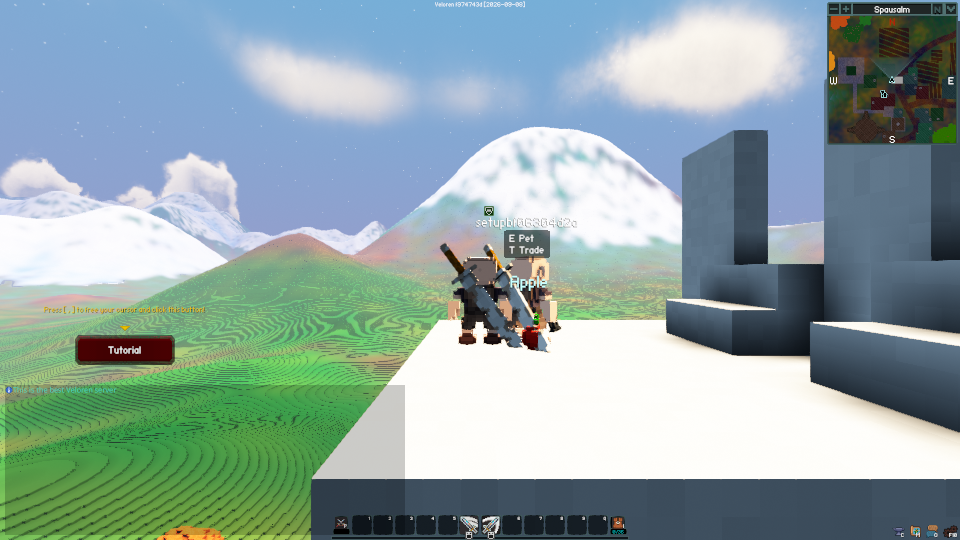

**Family:** Information Seeking & Dynamic Route Adaptation<br>
**Terrain:** flat<br>
**Required capabilities:** `coordinate_goal, movement, pickup, terrain_event`<br>
**Modalities:** Structured · Hybrid · Image (`visual-ui-v1`) — exact native-key admission applies.

**Scenario & initial state.** An authored flat-world route has a central staircase and a lawful north-side alternative. A designated loose apple is available; confirmed pickup triggers real stone collision blocks across the central passage.

**Agent challenge.** Collect the apple and deliver it while retaining it. Reconcile the changed geometry with the goal; an early alternative route is legal. This is an authored event, not a natural game collapse.

**Native oracle.** Correlated pickup of the designated supply, ≥1 apple retained, same living actor, and two grounded settled observations at the destination (1 m horizontal, 0.5 m vertical, ≤0.1 m/s, ≥0.25 s apart). The once-only terrain event and legal alternative must qualify. No required collision, particular path or inferred subjective replanning.

**Authored goal:** Collect the designated loose apple supply and carry at least one apple to the public destination alive. This private benchmark world includes an authored route-change event: after your actual apple pickup is confirmed, the central stair passage closes with real stone collision blocks. This is a benchmark-authored event, not a natural Veloren collapse. A legal north-side stair alternative remains. Choose any legal route, including choosing an alternative early; neither hitting the closure nor subjective replanning is required. Settle on the ground within one metre horizontally and half a metre vertically of the destination, at speed at most 0.1 m/s for two observations at least 0.25 seconds apart, retaining the apple.

[Native scorer / fixture source](harness/scripts/rpg_benchmark/navigation_tasks.py) · [中文详情](https://wyaaaattwho.github.io/VelorenBench/#task=T02)

</details>

### ❧ Crafting & Health Recovery

<details id="task-t03">
<summary><b>T03 · Food for Now, Reserves for Later</b></summary>

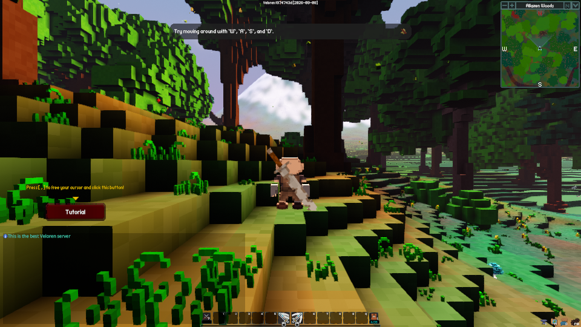

**Family:** Crafting & Health Recovery<br>
**Terrain:** natural<br>
**Required capabilities:** `crafting, inventory, movement, pickup`<br>
**Modalities:** Structured · Hybrid · Image (`visual-ui-v1`) — exact native-key admission applies.

**Scenario & initial state.** Start with an unlearned food recipe collection, 1 mushroom, 2 twigs and 1 apple. A nearby designated loose supply holds 2 more mushrooms; alternative food recipes share ingredients.

**Agent challenge.** Learn recipes, acquire missing mushrooms and craft one mushroom stick without exhausting the backup ingredients.

**Native oracle.** Alive same actor/session; actual recipe-group use and unknown→known transition; designated 2-mushroom pickup; own native mushroom_stick craft with output +≥1 and ingredient consumption (2 mushrooms +1 twig); final bag retains ≥1 mushroom stick, ≥1 raw mushroom, ≥1 twig and ≥1 apple simultaneously.

**Authored goal:** Learn the supplied food recipe collection and acquire mushrooms from the nearby loose mushroom supply. Make and keep one mushroom stick (common.items.food.mushroom_stick), while keeping at least one uncooked mushroom, one twig and one apple in your bag as backup ingredients. You start with partial ingredients; the food recipes include alternatives sharing these ingredients. Choose your own approach using normal game information. Stay alive.

[Native scorer / fixture source](harness/scripts/rpg_benchmark/crafting_recovery.py) · [中文详情](https://wyaaaattwho.github.io/VelorenBench/#task=T03)

</details>

<details id="task-t04">
<summary><b>T04 · A New Coat, an Old Shirt</b></summary>

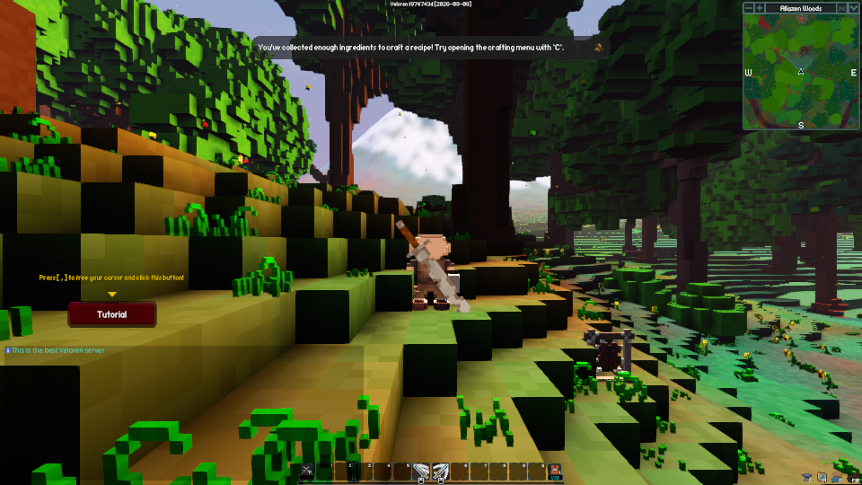

**Family:** Crafting & Health Recovery<br>
**Terrain:** natural<br>
**Required capabilities:** `crafting, equipment, inventory, movement`<br>
**Modalities:** Structured · Hybrid · Image (`visual-ui-v1`) — exact native-key admission applies.

**Scenario & initial state.** Begin wearing a worker shirt, with 5 raw animal hides and no leather or premade chest armor. A TanningRack and CraftingBench are nearby.

**Agent challenge.** Discover and execute the hide→leather→rawhide chest chain, wear the result and retain the replaced shirt.

**Native oracle.** Own correlated simple_leather transactions consume ≥5 hides and yield ≥5 leather; rawhide_chest transactions consume ≥5 leather and yield ≥1 chest. Actual chest-slot equip must match common.items.armor.hide.rawhide.chest; old worker shirt retained in bag; no hides/leather left; same actor alive throughout sampled history. Unlike C4, wearing the armor is required.

**Authored goal:** From your raw animal hides, make a rawhide chest armor (common.items.armor.hide.rawhide.chest) and actually wear it in your chest slot. Keep your replaced worker shirt (common.items.armor.misc.chest.worker_purple_brown) in your bag as backup clothing. Useful lawful workstations are nearby. You have no premade leather or chest armor. Choose your own stages and approach from normal recipe and game information; stay alive.

[Native scorer / fixture source](harness/scripts/rpg_benchmark/crafting_recovery.py) · [中文详情](https://wyaaaattwho.github.io/VelorenBench/#task=T04)

</details>

<details id="task-t05">
<summary><b>T05 · A Measured Recovery</b></summary>

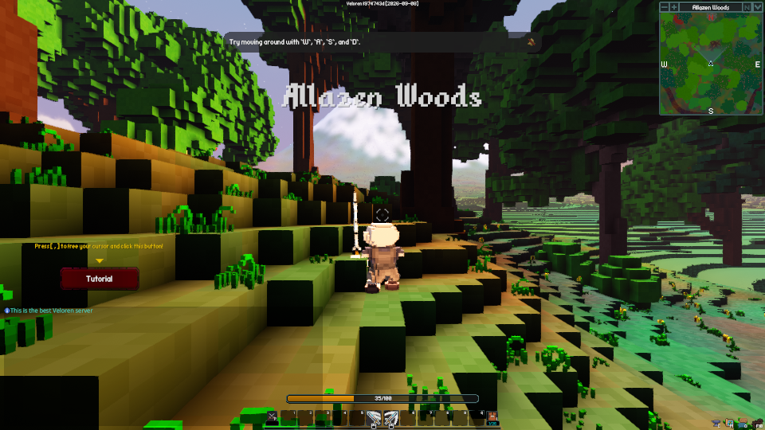

**Family:** Crafting & Health Recovery<br>
**Terrain:** natural<br>
**Required capabilities:** `inventory`<br>
**Modalities:** Structured · Hybrid · Image (`visual-ui-v1`) — **task-engineering only for Image**.

**Scenario & initial state.** Safe injured start: exactly 35/100 HP, no residual buffs, and 3 minor potions. Delayed effects and returned containers must be observed, not assumed.

**Agent challenge.** Recover to at least 80/100 HP while preserving at least 2 minor potions. Monitor the native health state and finite stock.

**Native oracle.** Correlated consumable use with a negative potion count delta; final HP ≥80 and maximum HP exactly 100, health increased from 35, ≥2 minor potions retained, same actor/session living with no sampled death. Consumption and later HP are joined; not all net HP is exclusively attributed to one item. Image is task-engineering-only, not capability admission.

**Authored goal:** You start injured in a safe area at 35/100 health, without residual buffs. Use actual recovery consumables to recover to at least 80/100 health (80 percent), while keeping at least two minor potions (common.items.consumable.potion_minor) in your bag as backup stock. You start with three minor potions. Effects may be delayed and containers may be returned; observe your health and supplies and choose your own recovery approach. Stay alive.

[Native scorer / fixture source](harness/scripts/rpg_benchmark/crafting_recovery.py) · [中文详情](https://wyaaaattwho.github.io/VelorenBench/#task=T05)

</details>

### ⚒ Foundational & Multi-Station Crafting

<details id="task-c1">
<summary><b>C1 · The First Mushroom Stick</b></summary>


**Family:** Foundational & Multi-Station Crafting<br>
**Terrain:** flat, natural<br>
**Required capabilities:** `crafting, inventory, movement`<br>
**Modalities:** Structured · Hybrid · Image (`visual-ui-v1`) — exact native-key admission applies.

**Scenario & initial state.** The character already knows the food recipe and has all ingredients: 2 mushrooms and 1 twig. Flat and natural fixtures are separate terrain cells.

**Agent challenge.** Find the legal craft interface and produce a mushroom stick, keeping rather than eating the product.

**Native oracle.** Same living actor/session; no product at opening; own completed native mushroom_stick craft, observed output +≥1 and input deltas ≤−2 mushrooms / ≤−1 twig; matching final inventory consumption and ≥1 product retained.

**Authored goal:** Make and keep one mushroom stick for food (common.items.food.mushroom_stick). Your character knows the recipe and has sufficient materials. Choose your own tools and approach using the game's current observations. Keep the product.

[Native scorer / fixture source](harness/scripts/rpg_benchmark/crafting.py) · [中文详情](https://wyaaaattwho.github.io/VelorenBench/#task=C1)

</details>

<details id="task-c2">
<summary><b>C2 · The Missing Ingredient</b></summary>

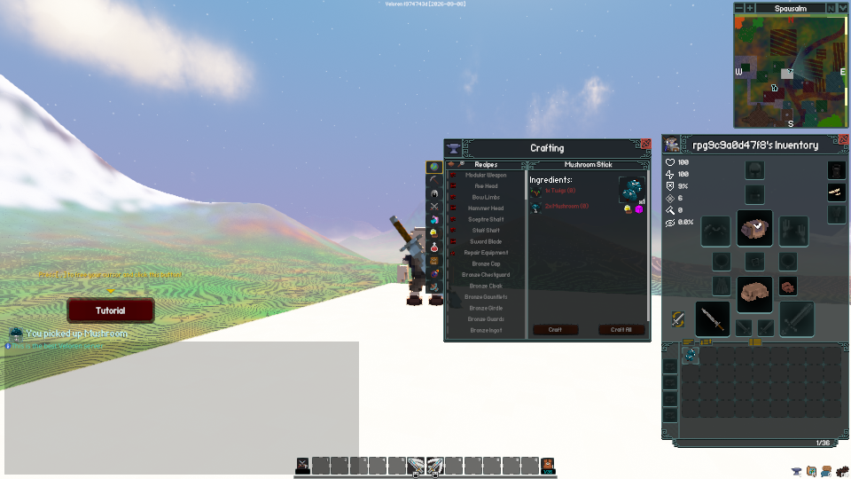

**Family:** Foundational & Multi-Station Crafting<br>
**Terrain:** flat, natural<br>
**Required capabilities:** `crafting, inventory, movement, pickup`<br>
**Modalities:** Structured · Hybrid · Image (`visual-ui-v1`) — exact native-key admission applies.

**Scenario & initial state.** Food recipes are known, but only 1 mushroom and 1 twig are supplied: one mushroom short of the recipe. Nearby loose supplies include the required mushroom and distractors.

**Agent challenge.** Inspect the recipe and world, select the missing supply, collect it and craft the retained meal.

**Native oracle.** Same living actor/session; pickup attributed to the exact required supply UID/item; own native craft transactions consume the recipe inputs and yield ≥1 mushroom stick; product absent at opening and retained in the final bag.

**Authored goal:** Make and keep one mushroom stick for food (common.items.food.mushroom_stick). You know the food recipes, but have only partial supplies. Find what you need in the environment using normal observation and keep the product.

[Native scorer / fixture source](harness/scripts/rpg_benchmark/crafting.py) · [中文详情](https://wyaaaattwho.github.io/VelorenBench/#task=C2)

</details>

<details id="task-c3">
<summary><b>C3 · Read the Recipe</b></summary>

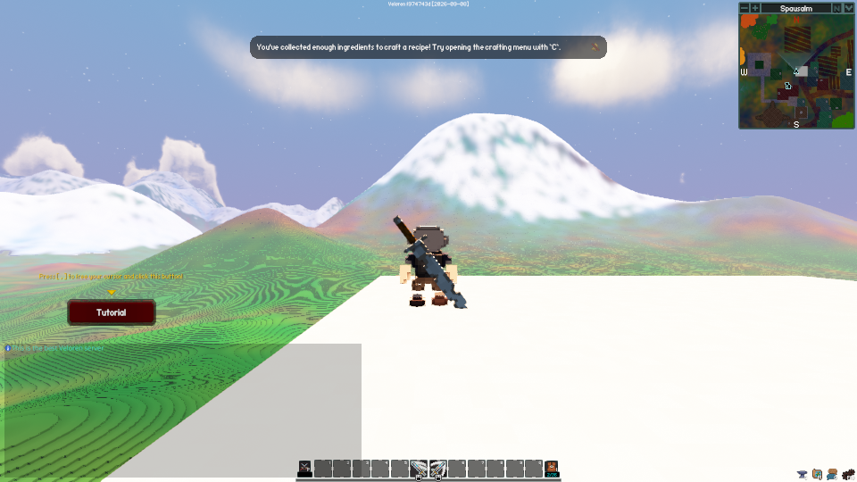

**Family:** Foundational & Multi-Station Crafting<br>
**Terrain:** flat, natural<br>
**Required capabilities:** `crafting, inventory, movement`<br>
**Modalities:** Structured · Hybrid · Image (`visual-ui-v1`) — exact native-key admission applies.

**Scenario & initial state.** The character’s food recipes are already known and 2 mushrooms plus 1 twig are supplied. The public goal does not spell out the recipe procedure. This is not a recipe-unlock task.

**Agent challenge.** Use normal game information to connect the desired food to its recipe and legal crafting action.

**Native oracle.** The same native craft/inventory predicate as C1: own completed craft consumes 2 mushrooms and 1 twig, output increases by≥1, product starts absent and remains in inventory, same actor/session alive. No C3U unlock predicate is silently added.

**Authored goal:** Make and keep one mushroom stick for food (common.items.food.mushroom_stick). Choose your own tools and approach using current game information.

[Native scorer / fixture source](harness/scripts/rpg_benchmark/crafting.py) · [中文详情](https://wyaaaattwho.github.io/VelorenBench/#task=C3)

</details>

<details id="task-c3u">
<summary><b>C3U · Knowledge Before Craft</b></summary>

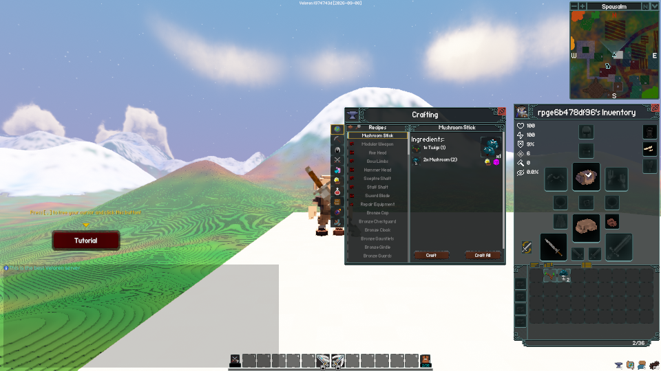

**Family:** Foundational & Multi-Station Crafting<br>
**Terrain:** flat, natural<br>
**Required capabilities:** `crafting, inventory, movement`<br>
**Modalities:** Structured · Hybrid · Image (`visual-ui-v1`) — exact native-key admission applies.

**Scenario & initial state.** Ingredients and a food recipe collection are supplied, but the character has not learned the recipe group. Future-option discovery is read-only and does not itself unlock anything.

**Agent challenge.** Recognize the knowledge gate, use the recipe collection, then craft and retain the mushroom stick.

**Native oracle.** C1’s own native craft, ingredient consumption, retained product and survival predicates, plus a correlated recipe-collection use action with definition count delta −1. Opening knowledge is fixture-validated as unlearned. Model ignorance is not inferred from character ignorance.

**Authored goal:** Make and keep one mushroom stick for food (common.items.food.mushroom_stick). Your supplies include a food recipe collection, but your character has not learned it. Choose your own tools and approach using normal game information.

[Native scorer / fixture source](harness/scripts/rpg_benchmark/crafting.py) · [中文详情](https://wyaaaattwho.github.io/VelorenBench/#task=C3U)

</details>

<details id="task-c4">
<summary><b>C4 · Hide to Leather to Armor</b></summary>

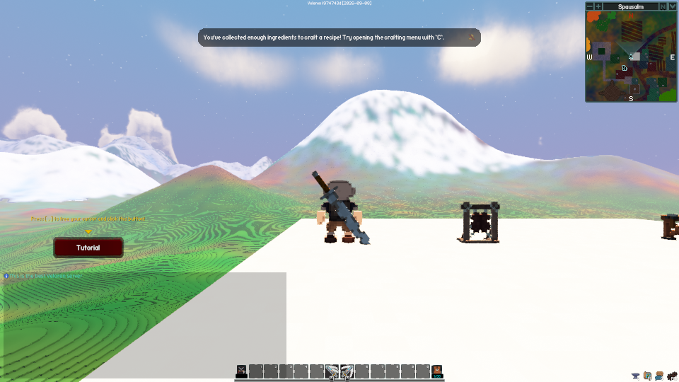

**Family:** Foundational & Multi-Station Crafting<br>
**Terrain:** flat, natural<br>
**Required capabilities:** `crafting, inventory, movement`<br>
**Modalities:** Structured · Hybrid · Image (`visual-ui-v1`) — exact native-key admission applies.

**Scenario & initial state.** Start with 5 raw animal hides, no leather and no rawhide chest. Nearby stations provide the multi-stage native production chain.

**Agent challenge.** Find the appropriate stations and recipes, produce leather and turn it into a chest armor. Keep the finished chest in the bag; equipping is not the C4 goal.

**Native oracle.** Own correlated craft transactions consume≥5 hides / yield≥5 leather, then consume≥5 leather / yield≥1 rawhide chest. Final bag retains≥1 chest with zero hides and zero leather; same actor/session alive. No pre-created intermediate/product at opening.

**Authored goal:** Make and keep a rawhide chest armor (common.items.armor.hide.rawhide.chest) from your raw supplies. Useful crafting stations are in the surrounding environment. Choose your own approach.

[Native scorer / fixture source](harness/scripts/rpg_benchmark/crafting.py) · [中文详情](https://wyaaaattwho.github.io/VelorenBench/#task=C4)

</details>

### ⚔ Combat Encounters

<details id="task-b1">
<summary><b>B1 · The Green Legoom</b></summary>

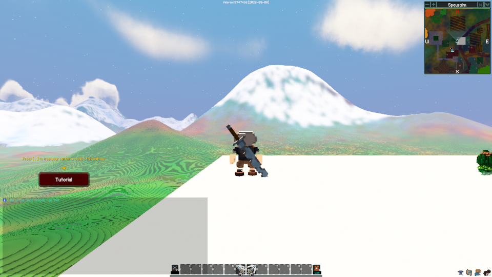

**Family:** Combat Encounters<br>
**Terrain:** flat, natural<br>
**Required capabilities:** `combat, inventory, movement`<br>
**Modalities:** Structured · Hybrid · Image (`visual-ui-v1`) — exact native-key admission applies.

**Scenario & initial state.** A designated hostile male Green Legoom uses its unchanged native loadout. The player has starter equipment and 2 minor potions; native enemy AI remains autonomous.

**Agent challenge.** Choose attacks, spacing and recovery to defeat the exact enemy and survive; disappearance alone is not death.

**Native oracle.** Exact target UID/control lifecycle, own server-attributed Attack damage, observed native target HP=0/dead, and player alive in the same session. B1–B3 additionally require the player to be the last observed damaging contributor; this is not an explicit death-transaction proof and differs from T06–T08.

**Authored goal:** Defeat the hostile Green Legoom in this encounter and survive. Choose your own combat tools, positioning and recovery.

[Native scorer / fixture source](harness/scripts/rpg_benchmark/combat.py) · [中文详情](https://wyaaaattwho.github.io/VelorenBench/#task=B1)

</details>

<details id="task-b2">
<summary><b>B2 · The Wolf</b></summary>


**Family:** Combat Encounters<br>
**Terrain:** flat, natural<br>
**Required capabilities:** `combat, inventory, movement`<br>
**Modalities:** Structured · Hybrid · Image (`visual-ui-v1`) — exact native-key admission applies.

**Scenario & initial state.** A designated hostile male Wolf with native FromBody loadout is spawned in a flat or natural fixture. Starter gear and 2 minor potions are available.

**Agent challenge.** Track the moving native enemy, manage contact and recovery, and resolve the encounter without dying.

**Native oracle.** Same living actor/session; exact Wolf lifecycle; own server-attributed Attack damage; target death directly observed; player is last observed damaging contributor. Despawn or lost visibility is not success; the engine exposes no explicit death transaction ID for this original family.

**Authored goal:** Defeat the hostile Wolf in this encounter and survive. Choose your own combat tools, positioning and recovery.

[Native scorer / fixture source](harness/scripts/rpg_benchmark/combat.py) · [中文详情](https://wyaaaattwho.github.io/VelorenBench/#task=B2)

</details>

<details id="task-b3">
<summary><b>B3 · The Ogre</b></summary>

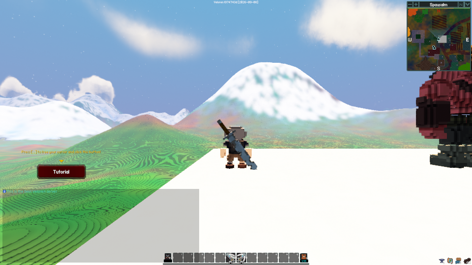

**Family:** Combat Encounters<br>
**Terrain:** flat, natural<br>
**Required capabilities:** `combat, inventory, movement`<br>
**Modalities:** Structured · Hybrid · Image (`visual-ui-v1`) — exact native-key admission applies.

**Scenario & initial state.** The designated hostile male Ogre (320 HP) retains its native Ogre hammer loadout. The player starts with the native Epic two-handed Frost Saw (common.items.weapons.sword.frost-1), otherwise unchanged starter equipment, and 3 minor potions in a flat or natural fixture; difficulty is not model-calibrated.

**Agent challenge.** Select positioning, attack opportunities and consumable use against the native Ogre while preserving survival.

**Native oracle.** Exact Ogre lifecycle, own server-attributed Attack damage, observed HP=0/dead target, last observed damaging contribution by the player, and same actor/session alive. This bounded attribution rule is not an unobserved last-blow claim.

**Authored goal:** Defeat the hostile male Ogre in this encounter and survive. Choose your own combat tools, positioning and recovery.

[Native scorer / fixture source](harness/scripts/rpg_benchmark/combat.py) · [中文详情](https://wyaaaattwho.github.io/VelorenBench/#task=B3)

</details>

### ♜ Tactical Combat Builds & Companion Support

<details id="task-t06">
<summary><b>T06 · Four Weapons, One Encounter</b></summary>

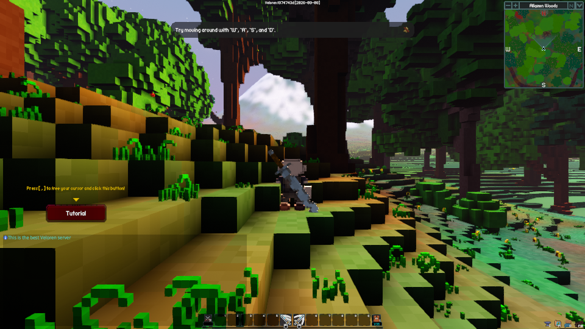

**Family:** Tactical Combat Builds & Companion Support<br>
**Terrain:** natural<br>
**Required capabilities:** `combat, equipment, movement`<br>
**Modalities:** Structured · Hybrid · Image (`visual-ui-v1`) — exact native-key admission applies.

**Scenario & initial state.** One Green Legoom encounter has sword, bow, staff and sceptre conditions, with finite recovery items. These are four configured variants of one task, not four professions or equally difficult tiers.

**Agent challenge.** Understand the selected build’s real controls, contribute damage and resolve the encounter while surviving. No prescribed attack sequence or last blow.

**Native oracle.** Private server entity/UID registry valid; designated target native death; own sourced health-damage applications joined to submitted combat intents; living same actor with no native/sampled death. All four weapon conditions are exact separate qualification selections, not separate tasks.

**Authored goal:** Resolve the authored encounter using your current weapon/build: the designated hostile Green Legoom must actually die, you must make a real damaging contribution to that enemy, and you must remain alive. Choose your own tactics, actions and recovery; no particular attack, order or last blow is required. Sword, bow, staff and sceptre are four configured conditions of this one task, not four professions or presumed equal difficulty.

[Native scorer / fixture source](harness/scripts/rpg_benchmark/combat_support.py) · [中文详情](https://wyaaaattwho.github.io/VelorenBench/#task=T06)

</details>

<details id="task-t07">
<summary><b>T07 · Forge an Active Sword Build</b></summary>

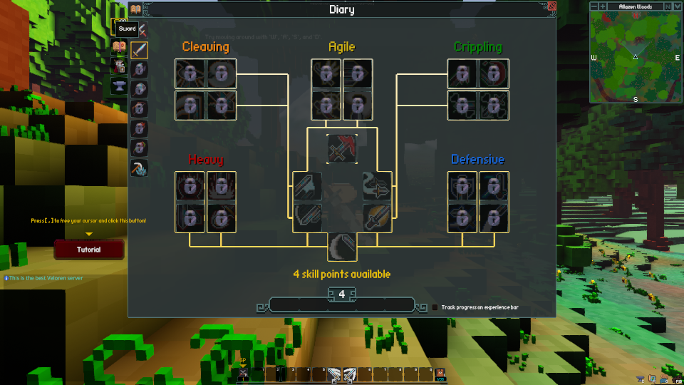

**Family:** Tactical Combat Builds & Companion Support<br>
**Terrain:** natural<br>
**Required capabilities:** `combat, movement, skills`<br>
**Modalities:** Structured · Hybrid · Image (`visual-ui-v1`) — exact native-key admission applies.

**Scenario & initial state.** Sword group unlocked; 4 finite Sword points, 0 unspent General points, actual native prerequisites, multiple legal active choices and 2 minor potions.

**Agent challenge.** Learn a legal active build, configure a learned ability in an auxiliary slot, and use that configured learned ability to cause damage before resolving the encounter.

**Native oracle.** Confirmed native unlock increases a learned skill level by 1 and reduces points by its positive expected cost; confirmed auxiliary configuration matches the requested ability. A causally attributed original Sword/MainWeaponAux attack must join the same learned active skill, configured slot, auxiliary-use intent and final learned skill to actual damaging application on the designated Legoom. The target must natively die, the player contribute damage and survive. Missing/ambiguous configured-effect provenance remains unknown; basic attacks alone cannot satisfy the learned-effect gate.

**Authored goal:** Use your finite native skill points to learn an active sword build, configure at least one ability you learned into an auxiliary slot, and use a configured learned active ability to cause an actual damaging effect on the designated hostile Green Legoom. Resolve the encounter by its actual death with your own damaging contribution, and survive. The Sword group is already unlocked; you have four Sword points and no unspent General points, actual native prerequisites and multiple legal active choices. Normal skill information explains the available choices and costs. No single build or tactic is prescribed, and basic attacks may also contribute to victory.

[Native scorer / fixture source](harness/scripts/rpg_benchmark/combat_support.py) · [中文详情](https://wyaaaattwho.github.io/VelorenBench/#task=T07)

</details>

<details id="task-t08">
<summary><b>T08 · Melee, Arrows and Cover</b></summary>

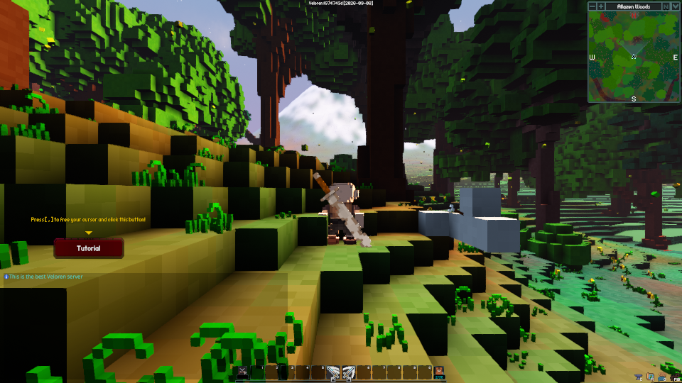

**Family:** Tactical Combat Builds & Companion Support<br>
**Terrain:** natural<br>
**Required capabilities:** `combat, inventory, movement`<br>
**Modalities:** Structured · Hybrid · Image (`visual-ui-v1`) — exact native-key admission applies.

**Scenario & initial state.** Simultaneous Green Legoom and Haniwa Archer threats. The archer keeps native weapon/armor/skills but starts at a disclosed 25 HP. Solid rock cover, a raised block and open flanks have real collision; a starter staff is optional.

**Agent challenge.** Choose target order, range, flanks and recovery under concurrent melee/ranged pressure. Cover, luring and the extra staff are available, not mandatory tactics.

**Native oracle.** Both exact registered targets must have native death events; own server-sourced damaging contribution joined to combat intents for each; same player alive with no sampled/native death. No last blow required, and success alone does not prove cover use or tactical reasoning.

**Authored goal:** Resolve both simultaneous hostile threats in this encounter: the designated melee Green Legoom and the designated ranged Haniwa Archer must actually die, you must make a real damaging contribution to each, and you must remain alive. The archer has its stock native weapon/armor/skills with a disclosed finite setup injury to 25 HP. The native terrain includes solid rock cover, a raised block and open flanks, with real collision and projectiles. Your inventory also contains one stock starter staff; equipping or using it is optional. Choose your own target order, spacing, recovery and tactics. Cover use is optional; suppression and luring are legal, and success alone is not evidence that you used spatial tactics.

[Native scorer / fixture source](harness/scripts/rpg_benchmark/combat_support.py) · [中文详情](https://wyaaaattwho.github.io/VelorenBench/#task=T08)

</details>

<details id="task-t09">
<summary><b>T09 · A Companion’s Lifeline</b></summary>

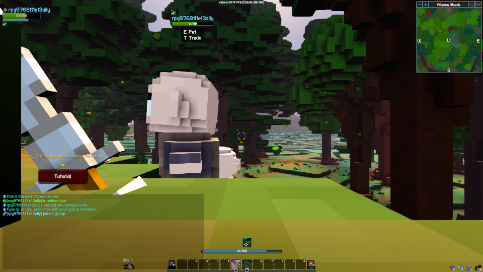

**Family:** Tactical Combat Builds & Companion Support<br>
**Terrain:** natural<br>
**Required capabilities:** `combat, movement, skills`<br>
**Modalities:** Structured · Hybrid · Image (`visual-ui-v1`) — exact native-key admission applies.

**Scenario & initial state.** A genuine native-Group companion starts at 60/100 HP. The player holds a sceptre and 4 finite combo from an expired disclosed setup resource buff. Setup healing never counts.

**Agent challenge.** Use the sceptre to actually heal the other Group member, keep both alive and resolve the Legoom threat. Self-healing and self potions are not companion support.

**Native oracle.** Submitted secondary-cast intent; source-attributed native Regeneration health application to the distinct same-Group companion; companion reaches≥61/100 HP and remains alive; enemy native death and player survival. No player last blow or player damage contribution is required by this support scorer.

**Authored goal:** Support your genuinely native-Group companion with your sceptre: you must cause actual healing to that other Group member, the companion must reach at least 61/100 health from its 60/100 injured start, the designated hostile Green Legoom must actually die, and both you and the companion must remain alive. You begin with four finite combo from a disclosed expired setup resource buff; setup does not count as healing. You may gain further resources normally. Healing yourself or using self potions is not companion healing; no last blow by you is required. Choose your own support/combat approach.

[Native scorer / fixture source](harness/scripts/rpg_benchmark/combat_support.py) · [中文详情](https://wyaaaattwho.github.io/VelorenBench/#task=T09)

</details>

### ⌖ Spatial & Town Navigation

<details id="task-n1">
<summary><b>N1 · Beyond the Wall</b></summary>

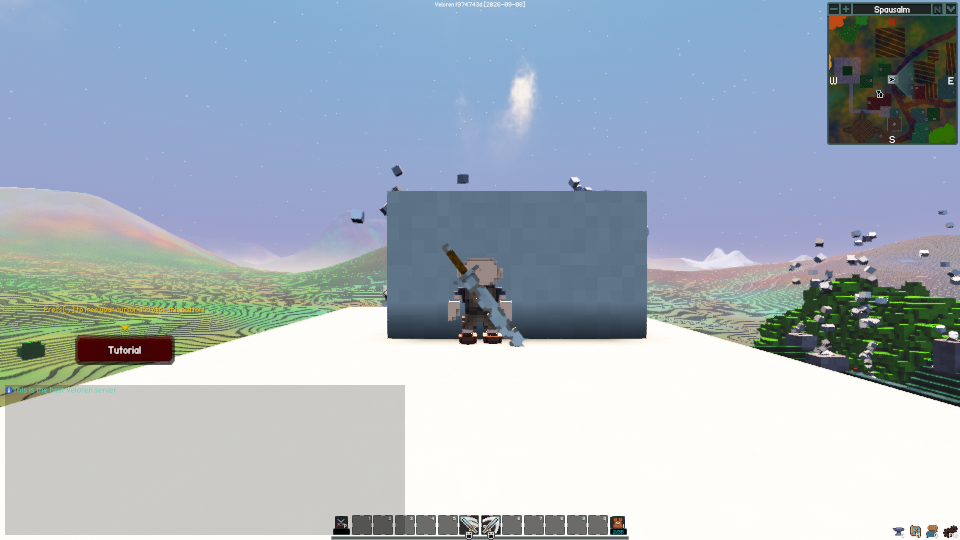

**Family:** Spatial & Town Navigation<br>
**Terrain:** flat<br>
**Required capabilities:** `coordinate_goal, movement`<br>
**Modalities:** Structured · Hybrid · Image (`visual-ui-v1`) — exact native-key admission applies.

**Scenario & initial state.** A flat authored wall_side_detour layout exposes an explicit player-visible rendezvous. The obstruction is read back as real native solid geometry.

**Agent challenge.** Read local geometry and reach the destination around the wall using owned movement rather than a private route or teleport.

**Native oracle.** Same living actor/session plus the original two-fresh-sample settled-arrival predicate: horizontal≤1 m, vertical≤1 m, speed≤0.1 m/s, samples≥0.25 s apart with advancing native ticks. This original navigation family does not add T01/T02’s explicit on_ground gate.

**Catalog description (runtime goal is fixture-generated):** Fixture-generated navigation goal; layout wall_side_detour. Reach the ordinary player-visible rendezvous in the authored layout.

[Native scorer / fixture source](harness/scripts/rpg_benchmark/navigation.py) · [中文详情](https://wyaaaattwho.github.io/VelorenBench/#task=N1)

</details>

<details id="task-n2">
<summary><b>N2 · The Staggered Path</b></summary>

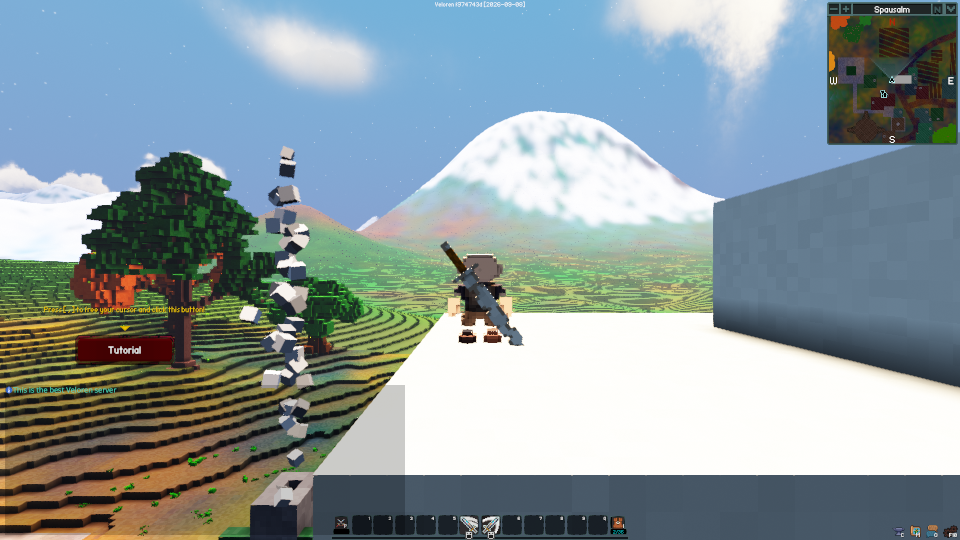

**Family:** Spatial & Town Navigation<br>
**Terrain:** flat<br>
**Required capabilities:** `coordinate_goal, movement`<br>
**Modalities:** Structured · Hybrid · Image (`visual-ui-v1`) — exact native-key admission applies.

**Scenario & initial state.** The flat staggered_s_turn authored layout requires several local heading changes. Despite the historical supply_rendezvous template name, this fixture has no required supply pickup.

**Agent challenge.** Maintain the visible coordinate goal across a sequence of staggered obstacles and settle accurately at the rendezvous.

**Native oracle.** Original native navigation arrival only: same living actor/session, final two correlated fresh samples with advancing ticks, ≥0.25 s apart, horizontal≤1 m / vertical≤1 m / speed≤0.1 m/s. No pickup success condition is invented from the template name.

**Catalog description (runtime goal is fixture-generated):** Fixture-generated navigation goal; layout staggered_s_turn. Reach the ordinary player-visible rendezvous in the authored layout.

[Native scorer / fixture source](harness/scripts/rpg_benchmark/navigation.py) · [中文详情](https://wyaaaattwho.github.io/VelorenBench/#task=N2)

</details>

<details id="task-n3">
<summary><b>N3 · The Side Steps</b></summary>

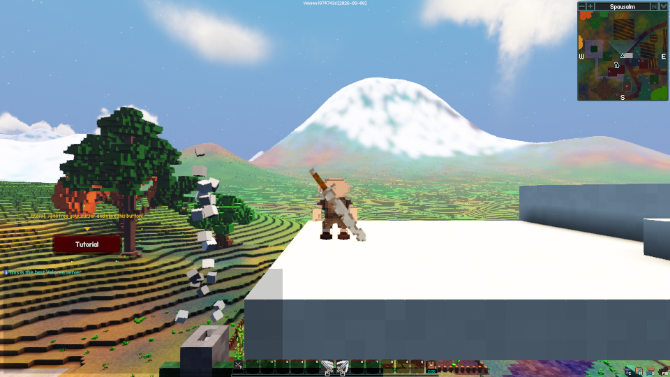

**Family:** Spatial & Town Navigation<br>
**Terrain:** flat<br>
**Required capabilities:** `coordinate_goal, movement`<br>
**Modalities:** Structured · Hybrid · Image (`visual-ui-v1`) — exact native-key admission applies.

**Scenario & initial state.** A flat-authored elevation_side_steps layout presents real elevated collision geometry and a player-visible goal.

**Agent challenge.** Reason about elevation and lawful side access rather than stopping at the goal’s horizontal projection.

**Native oracle.** Same living actor/session and original settled two-sample arrival: horizontal≤1 m and vertical≤1 m, speed≤0.1 m/s, advancing ticks, ≥0.25 s apart. Horizontal proximity alone is insufficient.

**Catalog description (runtime goal is fixture-generated):** Fixture-generated navigation goal; layout elevation_side_steps. Reach the ordinary player-visible rendezvous in the authored layout.

[Native scorer / fixture source](harness/scripts/rpg_benchmark/navigation.py) · [中文详情](https://wyaaaattwho.github.io/VelorenBench/#task=N3)

</details>

<details id="task-n4">
<summary><b>N4 · A Longer Way Through</b></summary>

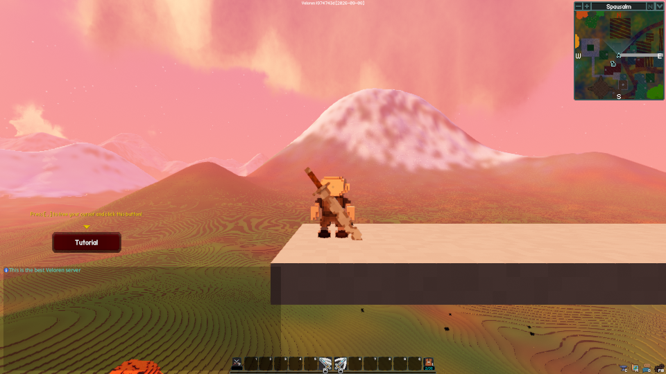

**Family:** Spatial & Town Navigation<br>
**Terrain:** flat<br>
**Required capabilities:** `coordinate_goal, movement`<br>
**Modalities:** Structured · Hybrid · Image (`visual-ui-v1`) — exact native-key admission applies.

**Scenario & initial state.** The flat long_distance_windows layout exposes the destination but requires sustained movement through authored geometry.

**Agent challenge.** Retain the long-range goal while grounding local movement decisions and avoiding premature arrival claims.

**Native oracle.** Same living actor/session and original settled-arrival pair (horizontal≤1 m, vertical≤1 m, speed≤0.1 m/s, fresh advancing ticks, ≥0.25 s separation). Path length or issuing move commands alone is not success.

**Catalog description (runtime goal is fixture-generated):** Fixture-generated navigation goal; layout long_distance_windows. Reach the ordinary player-visible rendezvous in the authored layout.

[Native scorer / fixture source](harness/scripts/rpg_benchmark/navigation.py) · [中文详情](https://wyaaaattwho.github.io/VelorenBench/#task=N4)

</details>

<details id="task-n5">
<summary><b>N5 · An Apple at Journey’s End</b></summary>

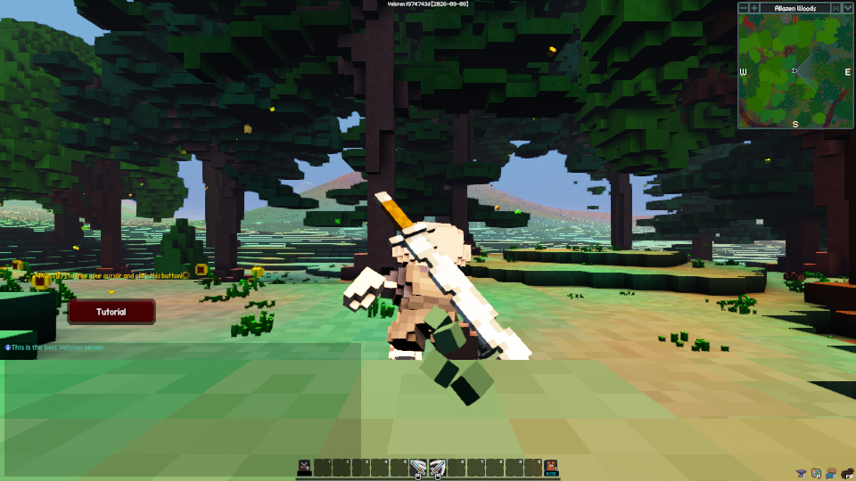

**Family:** Spatial & Town Navigation<br>
**Terrain:** natural<br>
**Required capabilities:** `coordinate_goal, movement, pickup`<br>
**Modalities:** Structured · Hybrid · Image (`visual-ui-v1`) — exact native-key admission applies.

**Scenario & initial state.** A natural-world destination is explicitly given in player-visible coordinates about 512 m east of the authored origin. A designated native apple drop waits at the endpoint; this is not named-site localization.

**Agent challenge.** Travel across native terrain, settle at the endpoint and collect the exact apple. The drop has its native 300-game-second lifetime; expiry is possible, not assumed from a clock alone.

**Native oracle.** Original two-sample settled arrival (1 m horizontal /1 m vertical /≤0.1 m/s /≥0.25 s with advancing ticks), same player alive, exact supply UID/item pickup attribution and final apple count greater than opening. Arrival and pickup availability are separate evidence; arrival alone is not full success.

**Catalog description (runtime goal is fixture-generated):** Fixture-generated navigation goal; layout natural_long. explicit player-visible location target, not named-site localization; pickup exact native apple at destination

[Native scorer / fixture source](harness/scripts/rpg_benchmark/navigation.py) · [中文详情](https://wyaaaattwho.github.io/VelorenBench/#task=N5)

</details>

<details id="task-n6">
<summary><b>N6 · Recover the Route</b></summary>

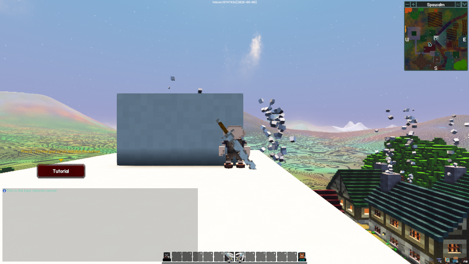

**Family:** Spatial & Town Navigation<br>
**Terrain:** flat<br>
**Required capabilities:** `coordinate_goal, movement`<br>
**Modalities:** Structured · Hybrid · Image (`visual-ui-v1`) — exact native-key admission applies.

**Scenario & initial state.** The recovery fixture displaces the actor natively before measurement while preserving the explicit macro destination. This is a setup-only displacement, not an undisclosed mid-run intervention.

**Agent challenge.** Re-localize from the displaced opening, preserve the overall goal and navigate to a stable arrival.

**Native oracle.** Same living actor/session, original two fresh correlated samples at the preserved goal, horizontal≤1 m /vertical≤1 m /speed≤0.1 m/s, advancing ticks and ≥0.25 s separation. No measured forced perturbation or subjective recovery inference is required.

**Catalog description (runtime goal is fixture-generated):** Fixture-generated navigation goal; layout recovery. explicit location target after a pre-measurement native displacement; macro goal retained

[Native scorer / fixture source](harness/scripts/rpg_benchmark/navigation.py) · [中文详情](https://wyaaaattwho.github.io/VelorenBench/#task=N6)

</details>

<details id="task-n7">
<summary><b>N7 · The Road to Spausalm</b></summary>


**Family:** Spatial & Town Navigation<br>
**Terrain:** natural<br>
**Required capabilities:** `map, movement`<br>
**Modalities:** Structured · Hybrid · Image (`visual-ui-v1`) — exact native-key admission applies.

**Scenario & initial state.** The public goal names the real native Town Spausalm, without destination coordinates or route. Native known-sites/map information supplies lawful localization; opening distance is at least 320 m.

**Agent challenge.** Resolve a town label through ordinary map knowledge, plan a long journey and enter the correct loaded native site.

**Native oracle.** Two fresh correlated observations ≥0.25 s apart, advancing ticks, grounded and speed≤0.1 m/s; within 32 m horizontal /6 m vertical of the qualified town center; native current-site name exactly matches the destination with loaded_chunk=true; same player alive. A64 m approach region is diagnostic, not the success radius.

**Catalog description (runtime goal is fixture-generated):** Fixture-generated navigation goal; layout named_site_long. real native town label from normal known_sites/InspectMap; no coordinates or route in task

[Native scorer / fixture source](harness/scripts/rpg_benchmark/navigation.py) · [中文详情](https://wyaaaattwho.github.io/VelorenBench/#task=N7)

</details>

### ◇ Mixed Multi-Objective Horizons

<details id="task-x1">
<summary><b>X1 · A Meal, a Fight, a Rendezvous</b></summary>

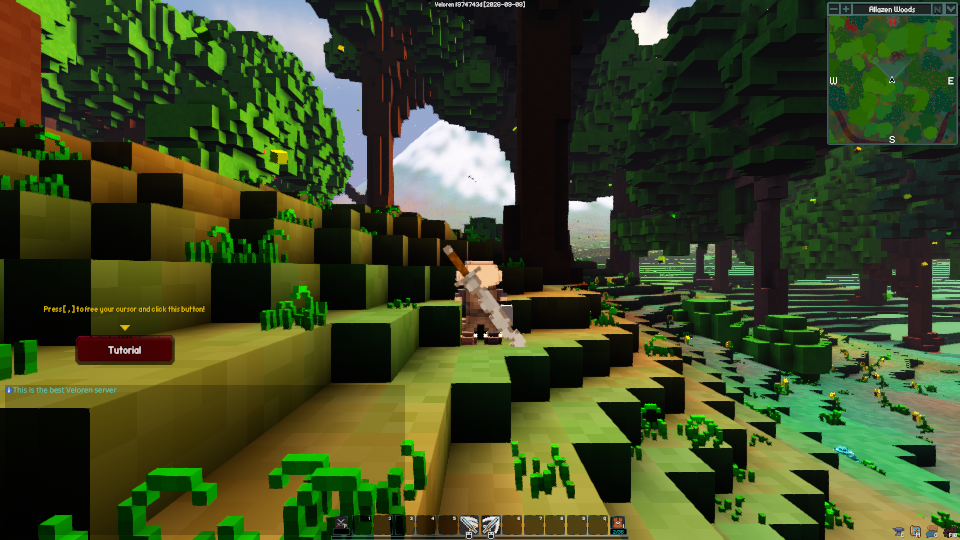

**Family:** Mixed Multi-Objective Horizons<br>
**Terrain:** natural<br>
**Required capabilities:** `combat, coordinate_goal, crafting, movement, pickup`<br>
**Modalities:** Structured · Hybrid · Image (`visual-ui-v1`) — exact native-key admission applies.

**Scenario & initial state.** A natural fixture composes C2’s partial-supply mushroom-stick crafting, a B1 Green Legoom encounter and a separate rendezvous apple. No strategic ordering is scripted.

**Agent challenge.** Allocate attention and resources among gathering, crafting, combat and travel, retaining all end goals instead of forgetting earlier work.

**Native oracle.** Conjunction of the unchanged component scorers: C2 exact supply pickup, native craft/input effects and retained mushroom stick; B1 exact target death, own damage and last observed damaging contribution with survival; navigation settled arrival plus pickup/retention of the separate rendezvous apple. All must hold for one living actor/session.

**Authored goal:** Prepare and keep a mushroom stick, reach the marked rendezvous and collect its apple, while surviving and resolving the hostile Green Legoom encounter. Decide how to combine the work yourself.

[Native scorer / fixture source](harness/scripts/rpg_benchmark/mixed.py) · [中文详情](https://wyaaaattwho.github.io/VelorenBench/#task=X1)

</details>

<details id="task-x2">
<summary><b>X2 · A Different Recipe, the Same Horizon</b></summary>

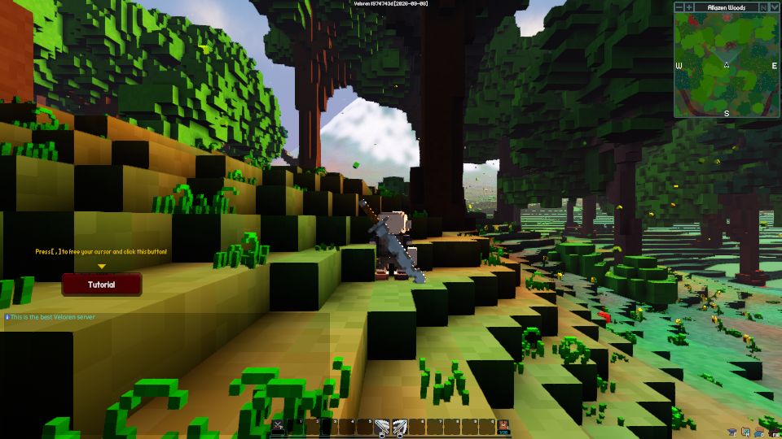

**Family:** Mixed Multi-Objective Horizons<br>
**Terrain:** natural<br>
**Required capabilities:** `combat, coordinate_goal, crafting, movement, pickup`<br>
**Modalities:** Structured · Hybrid · Image (`visual-ui-v1`) — exact native-key admission applies.

**Scenario & initial state.** The mixed composition swaps in apples_stick (1 apple +1 twig), supply offset[12,8] and rendezvous offset[64,−16]. It uses the same seed 130626853, not an unseen seed or necessarily unknown recipe.

**Agent challenge.** Adapt resource choices and route to the changed recipe/layout, retain an apple stick and the distinct rendezvous apple, and survive the encounter.

**Native oracle.** Same conjunction as X1 with the declared recipe override: required ingredient pickup; actual apples_stick craft with 1 apple /1 twig consumed and product retained; B1 native death/own damage/last observed contributor; settled destination arrival and exact rendezvous apple pickup with final apple count above opening. Held-out means composition/layout/recipe, not new seed.

**Authored goal:** Establish food readiness at the rendezvous: keep an apple stick (common.items.food.apple_stick), keep the rendezvous apple, and survive after defeating the hostile Green Legoom. Decide your own stages, resource choices, route and recovery while retaining this overall goal.

[Native scorer / fixture source](harness/scripts/rpg_benchmark/mixed.py) · [中文详情](https://wyaaaattwho.github.io/VelorenBench/#task=X2)

</details>

### ✉ NPC Trade & Quest Contracts

<details id="task-t10">
<summary><b>T10 · The Merchant’s Exchange</b></summary>

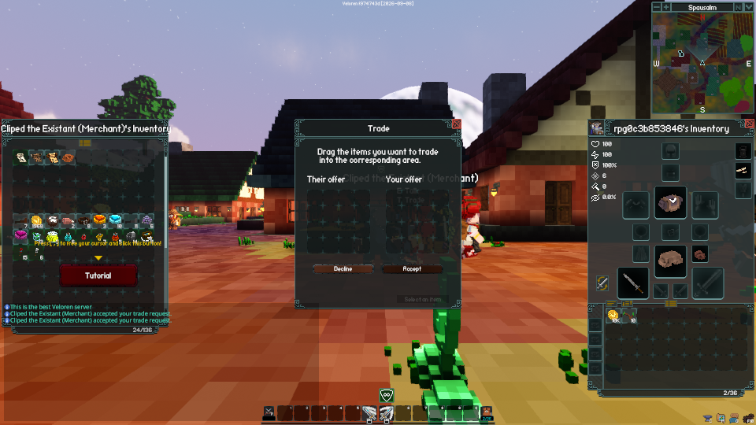

**Family:** NPC Trade & Quest Contracts<br>
**Terrain:** natural<br>
**Required capabilities:** `dialogue, movement, trade`<br>
**Modalities:** Structured · Hybrid · Image (`visual-ui-v1`) — exact native-key admission applies.

**Scenario & initial state.** The player starts at 100 HP with 10,000 coins and 10 twigs. The opening goal identifies the real merchant, stocked rawhide chest and reserves. Native bilateral offers expose stock and prices; legal payment combinations are not hardcoded.

**Agent challenge.** Sell at least 1 surplus twig, buy the specified chest, wear it, and keep at least 20 coins and 2 twigs while alive.

**Native oracle.** Actual committed merchant exchanges with exact parties/lifecycles/offers and inventory causality; ≥1 purchased target chest absent at opening; ≥1 twig sold with actual payment; correlated chest equip and correct final equipment slot; all reserves retained; same player alive. Native FinishedTrade has no TradeId: this documented attribution limit remains.

**Authored goal:** Sell some surplus materials to the named local merchant, buy the specified stocked equipment from that merchant, and actually wear it in its appropriate equipment slot. Keep the stated coin and material reserves in your bag and stay alive. The exact merchant, equipment and reserves are stated in your opening goal; normal merchant stock, native prices and bilateral offers are available through ordinary trade. Choose any legal payment combination satisfying these conditions.

[Native scorer / fixture source](harness/scripts/rpg_benchmark/npc_contracts.py) · [中文详情](https://wyaaaattwho.github.io/VelorenBench/#task=T10)

</details>

<details id="task-t11">
<summary><b>T11 · A Message for the Right Person</b></summary>

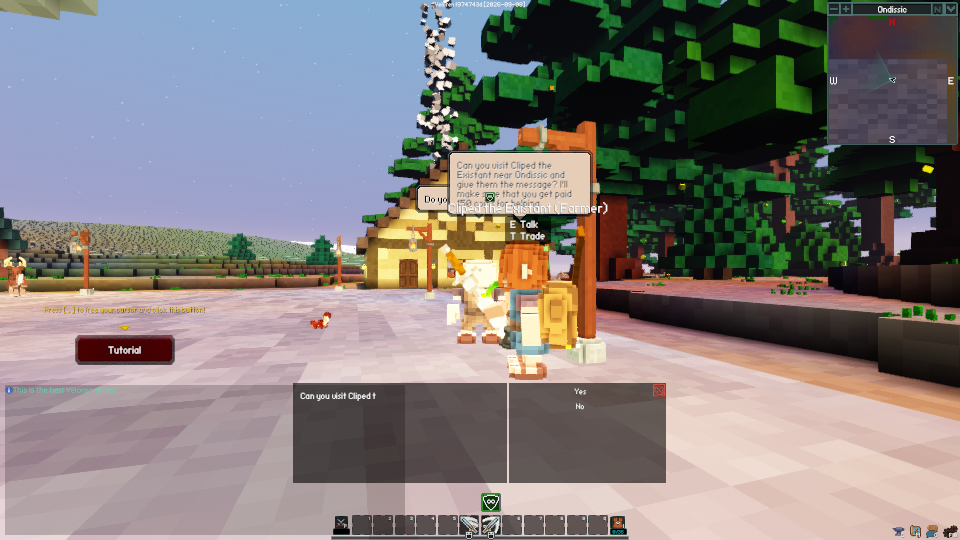

**Family:** NPC Trade & Quest Contracts<br>
**Terrain:** natural<br>
**Required capabilities:** `dialogue, map, movement`<br>
**Modalities:** Structured · Hybrid · Image (`visual-ui-v1`) — exact native-key admission applies.

**Scenario & initial state.** A real NPC offers a fresh, unaccepted native Message courier contract in the seed 1337 NPC world. The player starts at 100 HP with at least 3 free bag slots and no active quest. Identity/place clues and plausible local people must be distinguished; this is not an item-delivery contract.

**Agent challenge.** Accept through ordinary dialogue, preserve the contract identity, find the correct recipient and deliver for a real inventory reward.

**Native oracle.** Exact offered yes-response acceptance; one new matching unresolved Courier/Message quest with the player as messenger, correct distinct source/target actors and recipient arbiter; native resolution=true and actual reward insertion into the player bag; same actor/session alive with no sampled/private native death.

**Authored goal:** Accept the offered message-courier contract through normal dialogue. Remember its identity and place clues, find the correct recipient among the local people, deliver the message and receive the actual native reward in your bag. Stay alive. This is a Message contract, not an item-delivery alternative; choose your own conversations and route.

[Native scorer / fixture source](harness/scripts/rpg_benchmark/npc_contracts.py) · [中文详情](https://wyaaaattwho.github.io/VelorenBench/#task=T11)

</details>

<details id="task-t12">
<summary><b>T12 · The Slay Contract</b></summary>

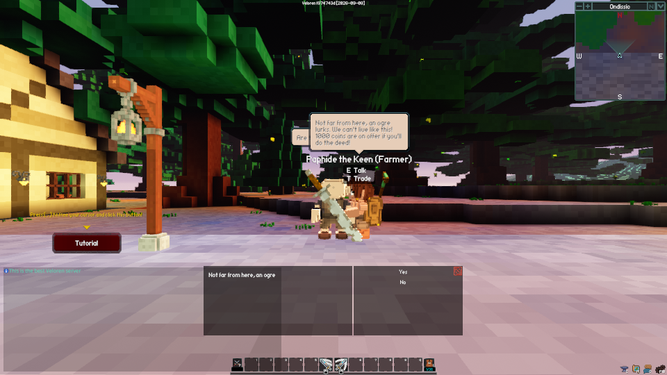

**Family:** NPC Trade & Quest Contracts<br>
**Terrain:** natural<br>
**Required capabilities:** `combat, dialogue, map, movement`<br>
**Modalities:** Structured · Hybrid · Image (`visual-ui-v1`) — exact native-key admission applies.

**Scenario & initial state.** A real giver offers a fresh native Slay contract in the seed 1337 NPC world. The player starts at 100 HP with an optional basic bow; the actual target begins more than 32 and at most 96 m away. The offered target is captured consistently during setup; lawful clues/markers identify it, and no post-offer relocation substitutes a different target.

**Agent challenge.** Accept, locate and defeat the contracted monster with valid own combat contribution, then return alive to report and obtain the native reward.

**Native oracle.** Exact offered acceptance and one new matching Slay quest (player slayer, actual target actor, giver arbiter); target native death and public player contribution after activation with run/actor/tick scope; native resolution=true and actual player reward inserted; same actor alive with no sampled/private death. No prescribed build or last blow. Historical structured replay is not a fresh native success.

**Authored goal:** Accept the offered native Slay contract through normal dialogue. Use its normal clues or marker to find the contracted monster, defeat that actual target with your own valid combat contribution, and return alive to the quest giver to report and receive the actual reward in your bag. Choose your own route, equipment, abilities and tactics; no particular build or last blow is required.

[Native scorer / fixture source](harness/scripts/rpg_benchmark/npc_contracts.py) · [中文详情](https://wyaaaattwho.github.io/VelorenBench/#task=T12)

</details>

<!-- END TASK COMPENDIUM -->

## Multi-harness validation & real gameplay

**E261** sampled `N5, T02, N1, T10, N6, N7` across **2 external harnesses × 3
modalities = 36 cells**, using task-selection seed `20261018` and benchmark
seed `130626853`. It is a bounded integration/video campaign, **not a full-catalog
leaderboard or model-ability estimate**. Runtime model metadata was unknown.

- **36 verified H.264 MP4 files, 4,320.833 seconds (72.014 minutes) total.**
- **27** full live 120-second videos; **9** include explicitly labelled static
  terminal holds after native success/death. **72 minutes is encoded duration,
  not 72 minutes of active gameplay.**
- **6** initial DeepSeek entries failed on a declaration `str`/`Path` bug.
  Canonical videos use independent retry aliases; original failed results remain.
- GameAgent required an adapter-local startup repair and reused an existing
  `torch 2.13.0+cu130`, rather than the missing earlier CPU wheel. These
  configuration deviations constrain interpretation.

The [interactive website](https://wyaaaattwho.github.io/VelorenBench/#validation)
shows every cell’s effective and original classification, retry identity and
video policy. Four short [gameplay excerpts](docs/assets/videos/) show genuine
live renderer windows from both harnesses, without terminal-hold segments.
Each has an MP4 and VP9/WebM rendition for browser codec compatibility.
The [public validation snapshot](docs/validation.json) records the bounded
campaign and limitations; excerpts have no audio and are presentation media,
not new evaluation runs.

## Quickstart

### 1. Install the Python harness

```sh
git clone https://github.com/wyaaaattwho/VelorenBench.git
cd VelorenBench
git checkout release/1.1.0
git rev-parse HEAD
python3.13 -B tools/package_source.py --check
python3.13 -m venv --copies .venv
.venv/bin/python -m pip install .
.venv/bin/rpg-benchmark identity
.venv/bin/rpg-benchmark tasks
.venv/bin/rpg-benchmark support
.venv/bin/rpg-benchmark validate-qualification
```

The package is `rpg-benchmark-harness`; the CLI is `rpg-benchmark`. These
inspection commands **do not** obtain game assets, launch a world, call a model
or certify native readiness. Core runtime dependencies are empty; build/test
dependencies are pinned separately in [TESTING.md](TESTING.md).
Historical `v1.0.1` identifies the earlier source-only release, not this branch.

### 2. Build / bind the native environment

Follow [BUILD.md](BUILD.md) to compile and assemble the selected native source,
or use a separately verified matching bundle. Only **Linux/aarch64** is selected;
other platforms and clean-machine setup are not established. Native execution
requires the pinned Rust toolchain, system libraries, GPU/Vulkan path, Xvfb and
**separately, legally obtained exact Veloren assets**. Neither raw game assets
nor native binaries are included in this Git checkout.

```sh
. .venv/bin/activate
rpg-benchmark bind-native \
  --native /absolute/native-dist/bundle.json \
  --native-sha256 DESCRIPTOR_SHA256 \
  --assets /absolute/veloren/assets --out /absolute/new-binding
rpg-benchmark check --backend renderer \
  --config /absolute/new-binding/runtime.json --config-sha256 RUNTIME_SHA256
rpg-benchmark support \
  --config /absolute/new-binding/runtime.json --config-sha256 RUNTIME_SHA256
```

Use the hashes printed by the tools; all output directories must be new and
outside protected inputs. `check` is read-only and does not launch native
processes. Bound support must match the exact native/profile/task selection.
Changing native/code/task bytes does not inherit an old qualification.

### 3. Validate a fixture, then connect your agent

```sh
# Setup starts native processes, but does not call a model or prove goal success.
rpg-benchmark run --backend renderer --mode setup \
  --config /absolute/new-binding/runtime.json --config-sha256 RUNTIME_SHA256 \
  --scene T05 --terrain natural --harness responses --observation-mode structured \
  --out /absolute/new-binding/runs/setup-001 \
  --recordings /absolute/work/outputs/recordings/setup-001
```

See [API.md](API.md) for the standard Responses provider declaration, image
transport, credentials via the environment and external adapter protocol.
[DeepSeek installation and preflight](integrations/deepseek/README.md) use the
official external `dsh` runtime, not a bundled copy or a task solver.
GameAgent is a separately supplied asynchronous Brain + Jev adapter.
All adapters must satisfy the same public boundary, negotiated profile,
attribution, validity and cleanup contracts; no provider access is supplied.

### 4. Watch, save an original PNG, or record MP4

```sh
# Read-only saved-frame browser; --port 0 chooses a free loopback port.
rpg-benchmark visualize serve --source /data/my-renderer-frames \
  --output-root /data/recordings/saved-review
rpg-benchmark visualize screenshot --source /data/my-renderer-frames \
  --out /data/recordings/shot-001
# Passive samples of the existing same-run registered X11 renderer:
rpg-benchmark visualize record --source /data/my-renderer-frames --passive \
  --capture-out /data/recordings/passive-001 --capture-fps 10 \
  --out /data/recordings/clip-001 --seconds 5
```

Use the exact run’s `--recordings` directory, not private run-result data.
The optional utility has no gameplay-control endpoints and does not start a
second observer or model. Passive recording requires ffmpeg/ffprobe with
libx264 and the registered Linux X11 renderer. Agent-requested frames can be
sparse; passive capture is independent of image requests. See
[VISUALIZATION.md](VISUALIZATION.md) for timing, storage and provenance.

## Reproducibility, scope & limitations

- Qualification is **engineering evidence**, not a task victory. Full-UI
  interfaces do not imply all models, providers or platforms succeed.
- Original navigation uses 1 m vertical arrival tolerance; T01/T02 use 0.5 m
  and explicit grounding; N7 uses its distinct town-center region. Do not
  replace task-specific success criteria with one generic “arrived” threshold.
- Original B-family and mixed tasks require the last **observed** damaging
  contributor; T06–T08 do not require a last blow. T09 requires other-member
  Group healing, not self-healing.
- T12 structured engineering evidence includes corrected replay of preserved
  native evidence, **not a fresh native structured success**.
- X2’s held-out claim is composition/layout/recipe, not an unseen seed.
- Native variable-dt simulation, frame/action ordering and clock mapping have
  uncertainty. Renderer/headless worlds and timing are not asserted equivalent.
- Package checks do not establish native build closure, deterministic replay,
  asset rights, clean-machine reliability or cross-platform support.
- The immutable local 1.1.0 delivery and evidence sidecar retain their original
  hashes. This documentation/site commit is a separate source state, not a
  rewrite of archived wheel/native/evidence identities.

## Repository guide

| Path | Contents |
| --- | --- |
| `harness/scripts/` | Python CLI, public tools, task families, adapters and private evaluators |
| `harness/tests/` | Unit and contract tests; synthetic inputs are not native results |
| `native/source/` | Selected modified Veloren GPL corresponding source |
| `native/*.json` | Native, interface and external-asset identities |
| `integrations/deepseek/` | Separate official-dsh adapter, installation and tests |
| `tools/` | Inventory, native build/assembly, documentation and site generation |
| `docs/` | Bilingual static project site, task compendium and attributed media |

Read [CONTRIBUTING.md](CONTRIBUTING.md), [BENCHMARK_CARD.md](BENCHMARK_CARD.md),
[SUPPORT.md](SUPPORT.md) and [PROVENANCE.md](PROVENANCE.md) before reporting
results or changing task semantics. Site development and checks:
[`docs/DEVELOPMENT.md`](docs/DEVELOPMENT.md).

## Licensing & acknowledgments

Original harness/tools/docs: **MIT**, retaining adapted GameAgent attribution.
Modified Veloren native source: **GPL-3.0-or-later**. Veloren art, fonts and
other upstream resources retain their **own terms**, not the harness MIT
license. Screenshots and silent gameplay excerpts are attributed in
[media notices](docs/assets/NOTICE.md), with source hashes and transformation
records. No raw game asset tree is distributed. See [NOTICE.md](NOTICE.md).

Thank you to the **Veloren contributors**, the **GameAgent** project, and the
**DeepSeek Harness** ecosystem. VelorenBench is independent, not an official
Veloren release or endorsement.

## Citation

No paper, authorship list or DOI is invented. Cite the repository, pin the
actual commit and add the native/package/evidence identities used in your work.

```bibtex
@misc{velorenbench2026,
  title        = {VelorenBench: An Open-World 3D Fantasy RPG Benchmark
                  for Autonomous Multimodal and Tool-Using Agents},
  year         = {2026},
  howpublished = {\url{https://github.com/wyaaaattwho/VelorenBench}},
  note         = {Engineering source 1.1.0; cite the exact commit and configuration}
}
```
